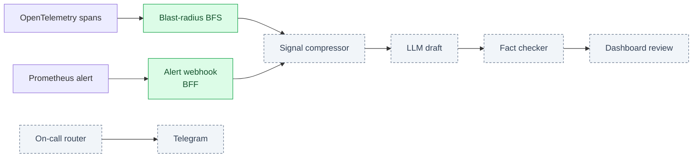

# Perimeter

[](https://github.com/SannidhiSriram-06/perimeter/actions/workflows/ci.yml)
[](LICENSE)

Self-hosted incident correlation and on-call routing for Kubernetes. Perimeter traces the real dependency chain behind an alert, drafts a root-cause report for a human to review, and pages the right responders. It runs entirely inside your cluster, so telemetry never leaves your infrastructure.

> Watching every edge of your infrastructure, from inside it.

## Why

- **Faster triage.** Engineers often spend 20–40 minutes digging through logs, metrics and traces for an incident. Perimeter walks OpenTelemetry trace edges from the alerting service, so only causally linked services are considered.
- **Auditable.** Blast-radius scoping is a deterministic graph traversal. Every "why we looked at this service" decision can be traced.
- **Data sovereignty.** No per-seat SaaS tier. Bring your own LLM key, or use a self-hosted model.

## How it works



Green components exist in the repository today. Grey components are planned. See [project_architecture_and_roadmap.md](project_architecture_and_roadmap.md) for the full design.

## Status

| Component | Status |
| :--- | :--- |
| Service dependency graph and BFS blast radius | Built, tested |
| Mock OpenTelemetry traces and alert fixtures | Built |
| Alert webhook (BFF): secret-protected, calls the engine, stores incidents | Built, tested |
| Correlation engine HTTP API (`POST /correlate`, upstream, downstream or both) | Built, tested |
| IAM login and role-scoped Team Directory API (BFF) | Built, tested against Postgres |
| Local PostgreSQL schema and seed data | Built |
| Minikube bootstrap: Prometheus, Alertmanager, Grafana, OTel Collector (Helm) | Built |
| Dockerfiles and a full local Compose stack (Postgres, engine, BFF) | Built |
| CI: tests with coverage gate, lint, security scans, image builds | Built |
| Signal compressor (rank and trim to token budget) | Planned |
| LLM root-cause draft and fact-checking validator | Planned |
| React dashboards | Planned |
| On-call router and Telegram bot | Planned |
| Chaos fault injection and accuracy benchmark | Planned |
| Terraform, ArgoCD, Vault, ECR deployment | Planned |

## Quick start

Requirements: Python 3.11+, Node.js 20+, Docker with Compose.

Run the correlation engine tests:

```bash
cd services/correlation_engine
pip install -r requirements-dev.txt
python3 -m pytest tests/
```

Run the demo. It starts Postgres, the correlation engine and the BFF in Docker, sends an alert to the webhook, and prints the stored incident with its blast radius:

```bash
./scripts/demo.sh
```

Print the mock telemetry summary without Docker: `cd services/correlation_engine && python -m src.mock`.

Start the stack yourself (the demo does this and also fills `.env` with random secrets):

```bash
cp .env.example .env   # then replace the change_me values
docker compose --env-file .env -f deploy/docker-compose.yml up -d --build
```

Demo logins use the seeded users (`10001` admin, `100101` team member) with the dev-only password `perimeter-dev`. See [deploy/README.md](deploy/README.md) for the database details.

Build the alert webhook service:

```bash
cd services/bff-server
npm ci
npm run build
```

## Repository layout

```
services/
  correlation_engine/   Python: graph, BFS blast radius, HTTP API (src/api.py), mock telemetry, Dockerfile
  bff-server/           Node.js: alert webhook (src/alerts), IAM login (src/auth), Team Directory API (src/teams), tests, Dockerfile
deploy/
  docker-compose.yml    Local stack: PostgreSQL, correlation engine, BFF
  db/init.sql           Schema and seed data
  k8s/                  Minikube bootstrap (up.sh, Helm values, sample trace job)
scripts/
  demo.sh               One-command demo
.github/                CI workflow and CODEOWNERS
```

## Contributing

See [CONTRIBUTING.md](CONTRIBUTING.md) for the branch model, pull request rules and commit format.

## Security

See [SECURITY.md](SECURITY.md) for how to report vulnerabilities.

## License

MIT. See [LICENSE](LICENSE).

*Academic note:* Perimeter is an engineering capstone project. Its accuracy claims are measured in a controlled, self-injected fault environment, not in production.
