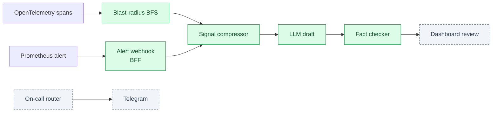

# Perimeter

[](https://github.com/SannidhiSriram-06/perimeter/actions/workflows/ci.yml)
[](LICENSE)

Self-hosted incident correlation and on-call routing for Kubernetes. Perimeter traces the real dependency chain behind an alert, drafts a root-cause report for a human to review, and pages the right responders. It runs entirely inside your cluster, so telemetry never leaves your infrastructure.

> Watching every edge of your infrastructure, from inside it.

## Why

- **Faster triage.** Engineers often spend 20–40 minutes digging through logs, metrics and traces for an incident. Perimeter walks OpenTelemetry trace edges from the alerting service, so only causally linked services are considered.
- **Auditable.** Blast-radius scoping is a deterministic graph traversal. Every "why we looked at this service" decision can be traced.
- **Data sovereignty.** No per-seat SaaS tier. Bring your own LLM key, or use a self-hosted model.

## How it works



Green components exist in the repository today and run end to end on mock telemetry. Grey components are planned (the dashboard has a login shell only). See [docs/design/Event_Store_Design.md](docs/design/Event_Store_Design.md) for the planned event store.

## Status

Last audited 2026-11-08 (`develop` @ `e2e34d7`): engine 177 tests, BFF 45 tests against Postgres, dashboard 8 tests, all passing; engine coverage 99%. About 40% of the proposal's scope is built. Everything the engine reasons about is still **mock telemetry**: there is no trace store or event store yet.

| Component | Status |
| :--- | :--- |
| Service dependency graph and BFS blast radius (upstream, downstream, both) | Built, tested |
| Mock OpenTelemetry spans, logs, metrics and alert fixtures | Built |
| Alert webhook (BFF): secret-protected, calls the engine, stores incidents, starts the draft | Built, tested. Known gaps: no de-duplication or resolve handling, no retry |
| Correlation engine HTTP API (`POST /correlate`, `POST /draft`, `GET /health`) | Built, tested. No auth or span-type checks yet |
| Signal compressor (rank evidence, trim to a token budget) | Built, tested (`services/correlation_engine/src/compressor`). Runs on fixture logs and metrics |
| LLM root-cause draft and fact-checking validator | Built, tested; run against Groq (`openai/gpt-oss-120b`, needs `GROQ_API_KEY`). Claim text is rendered from the checked fields. Free-tier rate limits can leave an incident without a draft |
| IAM login (scrypt) and role-scoped Team Directory API (BFF) | Built, tested against Postgres |
| Incidents API: `GET /api/v1/incidents`, admins see all, team members see their team's | Built, tested |
| PostgreSQL schema and seed data | Built. No migrations yet |
| Docker images and a full local Compose stack (Postgres, engine, BFF) | Built; `./scripts/demo.sh` passes |
| Minikube bootstrap: Prometheus, Alertmanager, Grafana, OTel Collector (Helm) | Built. BFF and engine are not deployed in the cluster yet |
| CI: tests with coverage gate, lint, security scans, image builds | Built |
| Chaos scenarios, ground truth, benchmark scorer, execution harness | Built; only the offline dry-run has been run (mock against mock, not an accuracy result) |
| React dashboard shell: Vite, login, role-guarded routes | Built, tested. The Admin and Team pages are placeholders |
| Dashboard screens (incident list, blast radius, claims, leave, directory) | Planned (wireframes in `docs/wireframes`) |
| Edit and finalize a draft (BFF endpoint and UI) | Planned |
| On-call router and Telegram bot | Planned |
| Raw event store (MongoDB design merged) and event fetcher | Planned (design only) |
| Live chaos run on instrumented test services; measured accuracy | Planned |
| Terraform, ArgoCD, Vault, ECR, RDS and DynamoDB deployment | Planned |

## Quick start

Requirements: Python 3.11+, Node.js 20+, Docker with Compose.

Run the correlation engine tests (includes the chaos harness tests):

```bash
cd services/correlation_engine
pip install -r requirements-dev.txt
python3 -m pytest tests/
```

Run the backend tests (they need PostgreSQL loaded from `deploy/db/init.sql`; see [deploy/README.md](deploy/README.md)) and the dashboard tests:

```bash
cd services/bff-server && npm ci && TEST_DATABASE_URL=postgres://perimeter:<password>@localhost:5432/perimeter_db npm test
cd services/dashboard && npm ci && npm test
```

Score the chaos scenarios offline: `python evaluation/run_chaos.py --scenario all --dry-run`.

Run the demo. It starts Postgres, the correlation engine and the BFF in Docker, sends an alert to the webhook, and prints the stored incident with its blast radius. It reuses an existing `.env` and database volume, so on a machine with real dev data it adds a row there. With `GROQ_API_KEY` set, a draft is added to the incident a few seconds later:

```bash
./scripts/demo.sh
```

Print the mock telemetry summary without Docker: `cd services/correlation_engine && python -m src.mock`.

Start the stack yourself (the demo does this and also fills `.env` with random secrets):

```bash
cp .env.example .env   # then replace the change_me values
docker compose --env-file .env -f deploy/docker-compose.yml up -d --build
```

Demo logins use the seeded users (`10001` admin, `100101` team member) with the dev-only password `perimeter-dev`. See [deploy/README.md](deploy/README.md) for the database details.

Build the alert webhook service:

```bash
cd services/bff-server
npm ci
npm run build
```

## Repository layout

```
services/
  correlation_engine/   Python (FastAPI): graph + BFS (src/graph), compressor (src/compressor), LLM draft + validator (src/llm), mock telemetry (src/mock), HTTP API (src/api.py), tests, Dockerfile
  bff-server/           Node.js: alert webhook (src/alerts), IAM login (src/auth), Team Directory (src/teams), incidents (src/incidents), tests, Dockerfile
  dashboard/            React + Vite + TypeScript shell: login, role guards, placeholder pages, tests
evaluation/
  chaos/                Chaos Mesh manifests (pod kill, network delay, stress)
  benchmark/            Ground truth, scorer, offline results
  run_chaos.py          Chaos execution harness (dry-run works offline; live mode needs a cluster)
deploy/
  docker-compose.yml    Local stack: PostgreSQL, correlation engine, BFF
  db/init.sql           Schema and dev seed data
  k8s/                  Minikube bootstrap (up.sh, Helm values, sample trace job)
docs/
  llm-output-schema.md  Contract between the model, the validator and the dashboard
  design/               Event_Store_Design.md
  evaluation/           Chaos_Scenarios.md
  wireframes/           Dashboard wireframes (SVG)
scripts/
  demo.sh               One-command demo
.github/                CI workflows and CODEOWNERS
```

## Contributing

See [CONTRIBUTING.md](CONTRIBUTING.md) for the branch model, pull request rules and commit format.

## Security

See [SECURITY.md](SECURITY.md) for how to report vulnerabilities.

## License

MIT. See [LICENSE](LICENSE).

*Academic note:* Perimeter is an engineering capstone project. Its accuracy claims are measured in a controlled, self-injected fault environment, not in production.
