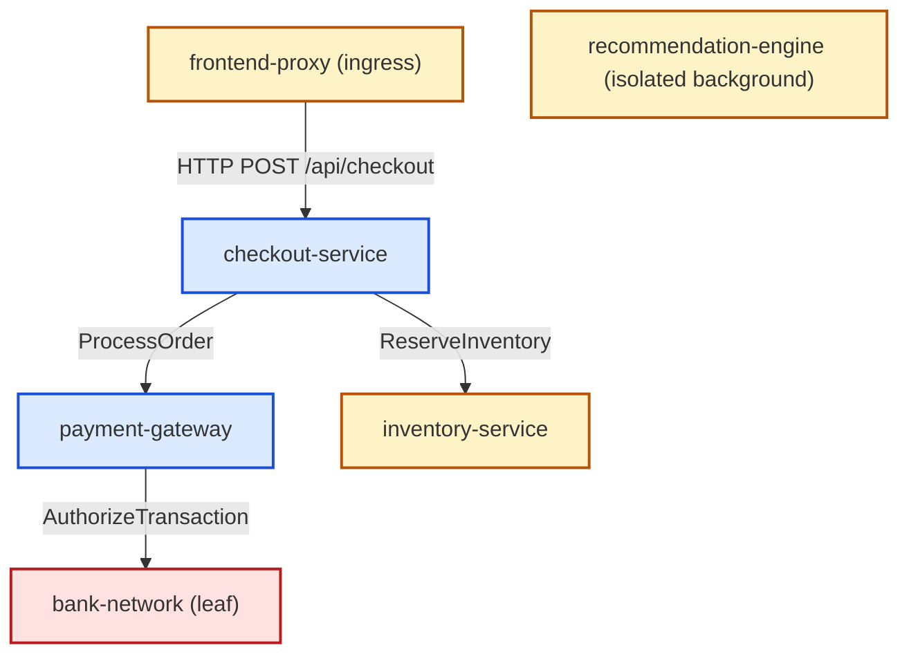

# Project Perimeter: Chaos Engineering Scenarios & Blast-Radius Ground Truth

> [!IMPORTANT]
> **Controlled Test Environment Notice**:
> All chaos engineering experiments and fault injection scenarios documented in this file are designed, configured, and executed **strictly within a controlled, synthetic test environment** (local Minikube / isolated staging Kubernetes cluster). They simulate realistic microservice failure modes for offline validation and **never target production systems**.

> [!NOTE]
> **Draft Manifest Status**:
> The Chaos Mesh manifests target namespace `perimeter-test` and selector labels (`app=`) that will be finalized once the hand-instrumented test microservice deployments land in the cluster (which currently uses `perimeter`). Additionally, `bank-network` is modeled as an external simulator in mock telemetry traces, so `NetworkChaos` will target its containerized stub deployment once provisioned in Kubernetes.

---

## 1. Overview & Service Call Topology

Project Perimeter correlates Kubernetes alerts and determines incident blast radiuses using OpenTelemetry trace edges traversed via Breadth-First Search (BFS). To rigorously evaluate the precision, recall, and reliability of the correlation engine, synthetic faults are injected into the instrumented microservice topology using Chaos Mesh.

### Microservice Ecosystem Under Test

The test bed consists of six containerized services partitioned into two engineering domains:

| Service Name | Tier | Owning Team | Role in System |
| :--- | :--- | :--- | :--- |
| `frontend-proxy` | High | `team-core-platform` | Ingress gateway routing incoming customer traffic |
| `checkout-service` | High | `team-payments` | Orchestrates order creation and payment authorization |
| `payment-gateway` | Critical | `team-payments` | Authorizes credit card and banking transactions |
| `bank-network` | Critical | `team-payments` | External core banking simulator / transaction clearing switch |
| `inventory-service` | High | `team-core-platform` | Stock verification and reservation |
| `recommendation-engine` | Medium | `team-core-platform` | Generates personalized product recommendations (decoupled) |

### Topology Graph



---

## 2. Fault Scenarios

### Scenario 1: Pod Crash on `payment-gateway` (`chaos-sc-01`)

* **Injected Fault Type**: `PodChaos` (`pod-kill`)
* **Target Service**: `payment-gateway` (namespace: `perimeter-test`, label: `app=payment-gateway`)
* **Fault Parameters**:
  - Action: `pod-kill`
  - Grace Period: `0s`
  - Duration: `60s`
* **Failure Mechanism**:
  Killing `payment-gateway` pods causes immediate TCP connection termination. Downstream callers (`checkout-service`) encounter connection refusal and return HTTP 500 responses upstream to `frontend-proxy`.
* **Alert Trigger**: Prometheus alert on `payment-gateway` pod availability (`PodNotReady` or HTTP 500 error rate > 5%).
* **Expected Blast Radius from Mock Trace Graph**:
  - **`upstream`** (callers affected by this outage):
    `["payment-gateway", "checkout-service", "frontend-proxy"]`
  - **`downstream`** (callees reachable from target):
    `["payment-gateway", "bank-network"]`
  - **`both`** (union of upstream callers and downstream callees):
    `["payment-gateway", "checkout-service", "bank-network", "frontend-proxy"]`
* **Negative Controls (Must NOT be in blast radius)**:
  - `inventory-service` (healthy sibling returning 200 OK; unaffected by payment-gateway failure)
  - `recommendation-engine` (completely disconnected service across all directions)

#### Chaos Mesh Manifest
```yaml
apiVersion: chaos-mesh.org/v1alpha1
kind: PodChaos
metadata:
  name: pod-kill-payment-gateway
  namespace: perimeter-test
  labels:
    perimeter.io/scenario: "chaos-sc-01"
spec:
  action: pod-kill
  mode: all
  selector:
    namespaces:
      - perimeter-test
    labelSelectors:
      app: payment-gateway
  gracePeriod: 0
```

---

### Scenario 2: Egress Latency & Socket Timeout on `bank-network` (`chaos-sc-02`)

* **Injected Fault Type**: `NetworkChaos` (`delay`)
* **Target Service**: `bank-network` (namespace: `perimeter-test`, label: `app=bank-network`)
* **Fault Parameters**:
  - Action: `delay`
  - Latency: `4000ms`
  - Jitter: `500ms`
  - Duration: `120s`
* **Failure Mechanism**:
  Synthetic network delay forces `ExternalBankAPI.AuthorizeTransaction` to exceed the 4000ms client timeout configured in `payment-gateway`. `payment-gateway` raises HTTP 504 Gateway Timeout, propagating failure cascades to `checkout-service` (P95 latency > 2s) and `frontend-proxy`.
* **Alert Trigger**: Prometheus alert `CheckoutServiceHighLatency` or `PaymentGatewayTimeout`.
* **Expected Blast Radius from Mock Trace Graph**:
  `bank-network` is a leaf dependency. Downstream traversal yields only itself; upstream traversal discovers all calling services in the cascade.
  - **`upstream`** (callers suffering the cascade):
    `["bank-network", "payment-gateway", "checkout-service", "frontend-proxy"]`
  - **`downstream`** (callees):
    `["bank-network"]`
  - **`both`** (all connected nodes):
    `["bank-network", "payment-gateway", "checkout-service", "frontend-proxy"]`
* **Negative Controls (Must NOT be in blast radius)**:
  - `inventory-service` (healthy secondary dependency, not in call path of `bank-network`)
  - `recommendation-engine` (unrelated concurrent noise)

#### Chaos Mesh Manifest
```yaml
apiVersion: chaos-mesh.org/v1alpha1
kind: NetworkChaos
metadata:
  name: network-latency-bank-network
  namespace: perimeter-test
  labels:
    perimeter.io/scenario: "chaos-sc-02"
spec:
  action: delay
  mode: all
  selector:
    namespaces:
      - perimeter-test
    labelSelectors:
      app: bank-network
  delay:
    latency: "4000ms"
    jitter: "500ms"
  direction: to
  duration: "120s"
```

---

### Scenario 3: Resource Starvation / Noisy Neighbor on `recommendation-engine` (`chaos-sc-03`)

* **Injected Fault Type**: `StressChaos` (`cpu` & `memory`)
* **Target Service**: `recommendation-engine` (namespace: `perimeter-test`, label: `app=recommendation-engine`)
* **Fault Parameters**:
  - Action: `stress-cpu`
  - Workers: `4`
  - CPU Load: `100%`
  - Memory: `512MB`
  - Duration: `90s`
* **Failure Mechanism**:
  CPU throttle and memory saturation exhaust the background inference worker pool. `RecommendationEngine.GetTrendingItems` fails with HTTP 503 Service Unavailable. Because this service is completely decoupled from the checkout path, this scenario verifies Perimeter's ability to isolate noisy neighbors and avoid false-positive blast-radius pollution.
* **Alert Trigger**: Prometheus alert `RecommendationEngineWorkerPoolExhausted`.
* **Expected Blast Radius from Mock Trace Graph**:
  Because `recommendation-engine` has zero upstream callers and zero downstream dependencies in the transaction trace graph:
  - **`upstream`**: `["recommendation-engine"]`
  - **`downstream`**: `["recommendation-engine"]`
  - **`both`**: `["recommendation-engine"]`
* **Negative Controls (Must NOT be in blast radius)**:
  - `frontend-proxy`
  - `checkout-service`
  - `payment-gateway`
  - `bank-network`
  - `inventory-service`
  *(All critical checkout path services must remain completely excluded from the blast radius.)*

#### Chaos Mesh Manifest
```yaml
apiVersion: chaos-mesh.org/v1alpha1
kind: StressChaos
metadata:
  name: stress-recommendation-engine
  namespace: perimeter-test
  labels:
    perimeter.io/scenario: "chaos-sc-03"
spec:
  mode: all
  selector:
    namespaces:
      - perimeter-test
    labelSelectors:
      app: recommendation-engine
  stressors:
    cpu:
      workers: 4
      load: 100
    memory:
      workers: 1
      size: "512MB"
  duration: "90s"
```

---

## 3. Ground-Truth Blast Radius Matrix

This matrix serves as the deterministic evaluation baseline for the correlation benchmark engine.

| Scenario ID | Fault Type | Target Service | Origin Service | Traversal Direction | Expected Blast Radius (Ground Truth) | Excluded Services (Negative Controls) |
| :--- | :--- | :--- | :--- | :--- | :--- | :--- |
| `chaos-sc-01` | `PodChaos` | `payment-gateway` | `payment-gateway` | `upstream` | `["payment-gateway", "checkout-service", "frontend-proxy"]` | `inventory-service`, `recommendation-engine` |
| `chaos-sc-01` | `PodChaos` | `payment-gateway` | `payment-gateway` | `both` | `["payment-gateway", "checkout-service", "bank-network", "frontend-proxy"]` | `inventory-service`, `recommendation-engine` |
| `chaos-sc-02` | `NetworkChaos` | `bank-network` | `bank-network` | `upstream` | `["bank-network", "payment-gateway", "checkout-service", "frontend-proxy"]` | `inventory-service`, `recommendation-engine` |
| `chaos-sc-02` | `NetworkChaos` | `bank-network` | `bank-network` | `both` | `["bank-network", "payment-gateway", "checkout-service", "frontend-proxy"]` | `inventory-service`, `recommendation-engine` |
| `chaos-sc-03` | `StressChaos` | `recommendation-engine` | `recommendation-engine` | `both` | `["recommendation-engine"]` | `frontend-proxy`, `checkout-service`, `payment-gateway`, `bank-network`, `inventory-service` |

---

## 4. Evaluation Scoring Metric Definitions

When comparing Perimeter's computed blast radius ($F$, Found Services) against the Ground Truth ($E$, Expected Services):

1. **True Positives ($TP$)**: Services correctly identified in the blast radius:
   $$TP = F \cap E$$
2. **False Positives ($FP$)**: Unrelated services incorrectly flagged:
   $$FP = F \setminus E$$
3. **False Negatives ($FN$)**: Impacted services missed by traversal:
   $$FN = E \setminus F$$
4. **Precision**:
   $$\text{Precision} = \frac{|TP|}{|TP| + |FP|} = \frac{|F \cap E|}{|F|}$$
5. **Recall**:
   $$\text{Recall} = \frac{|TP|}{|TP| + |FN|} = \frac{|F \cap E|}{|E|}$$
6. **$F_1$ Score**:
   $$F_1 = 2 \times \frac{\text{Precision} \times \text{Recall}}{\text{Precision} + \text{Recall}}$$

A scenario run is marked **PASSED** when $\text{Precision} \ge 0.80$ and $\text{Recall} \ge 0.80$.
