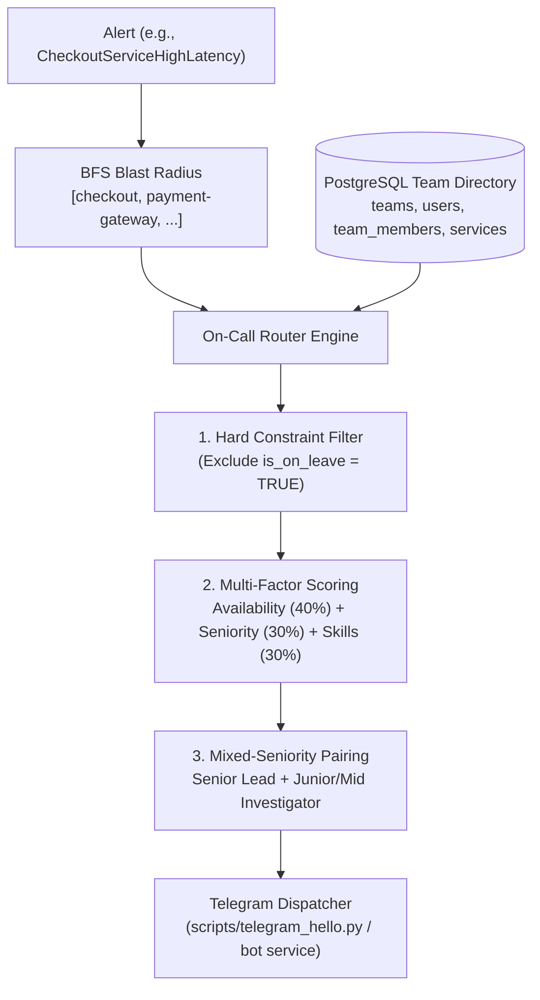

# Perimeter On-Call Router Scoring Specification

**Author:** Vivek Sana (On-Call Router and Bot Lead)  
**Status:** Draft / Ready for Review  
**Reviewer:** @SannidhiSriram-06 (Lead, Cloud and AI)  
**Target Module:** `services/correlation_engine/src/router/`  

---

## 1. Overview and Architecture

The **Perimeter On-Call Router** is responsible for identifying, ranking, and paging the optimal two responders whenever an incident is declared. 

In traditional alerting systems (e.g., PagerDuty or Opsgenie), routing is typically static—pages are sent either to a single round-robin on-call rotation or broadcast indiscriminately to entire team channels. Perimeter leverages real-time causal telemetry:
1. **Prometheus / Alertmanager** fires an alert on a failing service.
2. The **Correlation Engine** traverses the OpenTelemetry service dependency graph via BFS to establish the deterministic **blast radius**.
3. The **LLM Pipeline** synthesizes a root-cause hypothesis and citation-backed claims.
4. The **On-Call Router** maps the affected topology to team ownership, scores eligible engineers in the **Team Directory**, enforces the **mixed-seniority pairing rule**, and selects the primary and secondary responders.
5. The **Telegram Bot** delivers an actionable incident summary directly to the selected responders.



---

## 2. Input Data Model

The router consumes data from two sources: the **Incident Context** and the **Relational Team Directory** (stored in PostgreSQL via `deploy/db/init.sql` and exposed by the BFF Team Directory API in `services/bff-server/src/teams/routes.ts`).

### 2.1 Incident Context (Input Payload)

| Field | Type | Description |
| :--- | :--- | :--- |
| `incident_id` | `UUID` | Unique identifier of the incident (e.g., `gen_random_uuid()`). |
| `alert_service_id` | `VARCHAR(50)` | Service that triggered the Prometheus alert (e.g., `checkout-service`). |
| `blast_radius` | `List[str]` | Downstream and upstream services affected, determined by BFS traversal. |
| `root_cause_service` | `Optional[str]` | Service pinpointed by LLM hypothesis (falls back to `alert_service_id` if draft is pending or unconfirmed). |

### 2.2 Team Directory Schema (`deploy/db/init.sql`)

```sql
-- services table: maps microservices to owning teams and tiers
CREATE TABLE services (
    id VARCHAR(50) PRIMARY KEY,
    name VARCHAR(100) NOT NULL,
    owning_team_id VARCHAR(50) REFERENCES teams(id),
    tier VARCHAR(20) DEFAULT 'medium' -- 'critical', 'high', 'medium', 'low'
);

-- team_members table: tracks skills, leave, and on-call status
CREATE TABLE team_members (
    id SERIAL PRIMARY KEY,
    user_id VARCHAR(6) NOT NULL REFERENCES users(id) ON DELETE CASCADE,
    team_id VARCHAR(50) NOT NULL REFERENCES teams(id) ON DELETE CASCADE,
    seniority VARCHAR(20) CHECK (seniority IN ('junior', 'mid', 'senior', 'lead')),
    skills TEXT[] DEFAULT '{}',
    telegram_chat_id VARCHAR(50),
    is_on_leave BOOLEAN DEFAULT FALSE,
    on_call_status BOOLEAN DEFAULT FALSE,
    CONSTRAINT uq_team_members_user_team UNIQUE (user_id, team_id)
);
```

---

## 3. Team Mapping & Ownership Hierarchy

An incident rarely affects only one isolated service. The router establishes team relevance by analyzing both the **Primary Alert Service** and the broader **Blast Radius**.

### 3.1 Primary vs. Secondary Ownership
1. **Primary Owning Team ($T_{\text{primary}}$):**
   The team registered as the owner of the `alert_service_id` (or `root_cause_service` when confirmed by the LLM). This team bears primary operational accountability.
   $$\text{Team}_{\text{primary}} = \text{services.owning\_team\_id where id} = \text{alert\_service\_id}$$
2. **Secondary Owning Teams ($T_{\text{secondary}}$):**
   Teams owning other services present in the `blast_radius` list. These teams represent upstream callers suffering degradation or downstream dependencies causing latency.
   $$\text{Teams}_{\text{secondary}} = \{ \text{services.owning\_team\_id for } s \in \text{blast\_radius} \} \setminus \{ T_{\text{primary}} \}$$

### 3.2 Team Affiliation Multiplier ($M_{\text{team}}$)
Candidate engineers are scoped by their team affiliation:
- **Primary Team Member:** $M_{\text{team}} = 1.0$ (Full weighting).
- **Secondary Blast-Radius Team Member:** $M_{\text{team}} = 0.5$ (Consulted or escalated if primary is unavailable).
- **Unrelated Team Member:** $M_{\text{team}} = 0.0$ (Excluded from initial routing).

---

## 4. Eligibility Filter (Hard Constraints)

Before calculating numerical scores, the router applies hard boolean filters:

1. **Leave Filter (`is_on_leave == TRUE`):**
   - **Rule:** Any member with `is_on_leave = true` is **immediately excluded** ($Score = 0$).
   - **Rationale:** Paging an engineer on vacation or medical leave violates on-call safety, causes alert delays, and increases Mean Time to Acknowledge (MTTA).
2. **Notification Capability (`telegram_chat_id IS NULL` or empty):**
   - **Rule:** Members without a registered Telegram chat ID cannot receive automated alerts and are filtered out of the active dispatch list with a log warning.
3. **Active Membership:**
   - **Rule:** Must belong to an active team involved in the incident topology.

---

## 5. Scoring Formulation & Numerical Weights

For every eligible candidate $m$, the composite score $S(m) \in [0, 100]$ is computed as a weighted linear combination of three core operational factors:

$$S(m) = M_{\text{team}} \times \Big( W_{\text{avail}} \cdot S_{\text{avail}}(m) + W_{\text{seniority}} \cdot S_{\text{seniority}}(m) + W_{\text{skill}} \cdot S_{\text{skill}}(m) \Big)$$

Where weights sum to $1.0$:
- **Availability Weight ($W_{\text{avail}}$):** $0.40$ (40%)
- **Seniority Weight ($W_{\text{seniority}}$):** $0.30$ (30%)
- **Skill Match Weight ($W_{\text{skill}}$):** $0.30$ (30%)

```
┌─────────────────────────────────────────────────────────────┐
│                   Composite Score (100%)                    │
├──────────────────────┬──────────────────────┬───────────────┤
│  Availability (40%)  │   Seniority (30%)    │  Skill (30%)  │
│  on_call_status      │   lead/senior/mid/jr │  domain tags  │
└──────────────────────┴──────────────────────┴───────────────┘
```

### 5.1 Factor 1: Availability / On-Call Status ($W_{\text{avail}} = 0.40$)
- **Rationale:** Respecting shift rotations is vital for team sustainability. The scheduled on-call responder should take priority.
- **Scoring:**
  - `on_call_status == TRUE`: **$100$ points**
  - `on_call_status == FALSE`: **$20$ points** (off-shift but reachable as backup)

### 5.2 Factor 2: Seniority Level ($W_{\text{seniority}} = 0.30$)
- **Rationale:** Production outages (especially on `critical` or `high` tier services) require technical authority to authorize rollbacks, failover traffic, or coordinate cross-team mitigation.
- **Scoring:**
  - `lead`: **$100$ points** (Architectural leader, incident incident commander)
  - `senior`: **$80$ points** (Deep systems experience, production debugging proficiency)
  - `mid`: **$50$ points** (Competent on service features and standard runbooks)
  - `junior`: **$25$ points** (Early career, participates alongside a lead)

### 5.3 Factor 3: Skill Match ($W_{\text{skill}} = 0.30$)
- **Rationale:** Fast diagnosis requires familiarity with the affected service's tech stack (e.g., Python, Go, PostgreSQL, Kubernetes).
- **Service Domain Skills:** Each service in Perimeter has implicit tech tags based on its implementation:
  - `checkout-service`: `['python', 'fastapi', 'postgresql', 'payments']`
  - `payment-gateway`: `['go', 'distributed-systems', 'payments']`
  - `bank-network`: `['go', 'networking', 'security', 'payments']`
  - `frontend-proxy`: `['kubernetes', 'networking', 'opentelemetry']`
  - `inventory-service`: `['postgresql', 'python', 'grpc']`
- **Scoring Formulation:** Let $K_{\text{incident}}$ be the union of skills relevant to the primary alerting service and immediate failing dependencies, and $K_m$ be the candidate's skills array:
  $$S_{\text{skill}}(m) = \min\left(100, \frac{|K_m \cap K_{\text{incident}}|}{\max(1, |K_{\text{incident}}|)} \times 100 \times 1.5\right)$$
  *(Scaled by $1.5$ so matching 2-3 key domain skills achieves strong scores, avoiding penalties for irrelevant tags).*

---

## 6. Mixed-Seniority Pairing Rule

Perimeter always dispatches pages to **two responders**:
1. **Primary Responder (Incident Commander / Senior Lead):**
   - **Role:** Leads triage, makes architectural decisions, authorizes mitigation/rollback, and communicates with leadership.
   - **Requirement:** Chosen from the **Senior Pool** (`senior` or `lead`).
2. **Secondary Responder (Investigator / Junior-Mid Mentee):**
   - **Role:** Inspects trace spans, checks logs, verifies database health, writes the initial incident notes, and learns outage handling.
   - **Requirement:** Chosen from the **Junior/Mid Pool** (`mid` or `junior`).

### 6.1 Selection Algorithm
1. Filter candidates for `is_on_leave == FALSE` and $M_{\text{team}} > 0$.
2. Compute composite scores for all remaining candidates.
3. Partition candidates into:
   - **Senior Pool ($P_{\text{senior}}$):** `{ m | m.seniority IN ('lead', 'senior') }`
   - **Junior/Mid Pool ($P_{\text{junior}}$):** `{ m | m.seniority IN ('mid', 'junior') }`
4. **Responder 1 (Primary):**
   $$\text{Resp}_1 = \operatorname{argmax}_{m \in P_{\text{senior}}} S(m)$$
5. **Responder 2 (Secondary):**
   $$\text{Resp}_2 = \operatorname{argmax}_{m \in P_{\text{junior}}} S(m)$$

### 6.2 Degenerate / Boundary Cases
- **Case A: No Junior/Mid available in Primary Team:**
  Select the 2nd highest-scoring candidate from $P_{\text{senior}}$. Two seniors will co-triage.
- **Case B: No Senior/Lead available in Primary Team:**
  Select the highest-scoring candidate from $P_{\text{junior}}$, and trigger **Tier 1 Fallback** to bring in a Senior/Lead from a secondary blast-radius team or Core Platform.

---

## 7. Fallback Escalation Hierarchy

When the primary owning team cannot fulfill responder pairing (e.g., all members on leave or off-duty), the router escalates along three tiers:

```
[Level 0: Primary Owning Team]
          │
          ▼ (If <2 responders available)
[Level 1: Secondary Blast-Radius Teams]
(Teams owning degraded dependencies in the BFS trace graph)
          │
          ▼ (If still no senior lead)
[Level 2: Core Platform On-Call]
(team-core-platform on-call engineer, e.g., Ken Platform)
          │
          ▼ (If catastrophic outage / platform unavailable)
[Level 3: Admin Escalation]
(Paged directly: 10001 Alex Admin)
```

1. **Level 0 (Primary Team):** Evaluate members of $T_{\text{primary}}$.
2. **Level 1 (Blast-Radius Secondary Teams):** If a role cannot be filled, evaluate members of $T_{\text{secondary}}$ with $M_{\text{team}} = 0.5$.
3. **Level 2 (Core Platform Fallback):** If no senior lead is found across affected teams, automatically pull the on-call engineer from `team-core-platform` (e.g., Ken Platform).
4. **Level 3 (Emergency Admin):** If all candidate sets are empty, dispatch an emergency page to `admin` (`10001 Alex Admin`).

---

## 8. Fully Worked Examples

### 8.1 Example 1: Standard Checkout Service Cascade

**Incident Details:**
- **Alert:** `CheckoutServiceHighLatency`
- **Alerting Service:** `checkout-service` (Tier: `high`)
- **Primary Team:** `team-payments` (owns `checkout-service`, `payment-gateway`, `bank-network`)
- **Blast Radius:** `[checkout-service, payment-gateway, inventory-service, bank-network, frontend-proxy]`
- **Required Domain Skills:** `['payments', 'distributed-systems', 'fastapi', 'postgresql', 'python']`

**Candidate Directory Pool:**
1. **Dev Dave (`100101`):**
   - Team: `team-payments` ($M_{\text{team}} = 1.0$)
   - Seniority: `mid`
   - Skills: `['python', 'postgresql', 'fastapi']` (3 matches: `python`, `postgresql`, `fastapi`)
   - `on_call_status`: `TRUE`
   - `is_on_leave`: `FALSE`
2. **Sara Senior (`100102`):**
   - Team: `team-payments` ($M_{\text{team}} = 1.0$)
   - Seniority: `lead`
   - Skills: `['go', 'distributed-systems', 'payments']` (2 matches: `distributed-systems`, `payments`)
   - `on_call_status`: `FALSE`
   - `is_on_leave`: `FALSE`
3. **Ken Platform (`100103`):**
   - Team: `team-core-platform` (Secondary team, owns `inventory-service` & `frontend-proxy` in blast radius: $M_{\text{team}} = 0.5$)
   - Seniority: `senior`
   - Skills: `['kubernetes', 'terraform', 'opentelemetry']` (0 domain matches)
   - `on_call_status`: `TRUE`
   - `is_on_leave`: `FALSE`

#### Score Calculations

**1. Dev Dave (`100101`):**
- Availability: $S_{\text{avail}} = 100$ (on call)
- Seniority: $S_{\text{seniority}} = 50$ (`mid`)
- Skill Match: 3 of 5 skills matched $\rightarrow \min(100, (3/5) \times 100 \times 1.5) = 90$
- Raw Score:
  $$\text{Raw} = (0.40 \times 100) + (0.30 \times 50) + (0.30 \times 90) = 40 + 15 + 27 = 82.0$$
- Team Multiplier: $M_{\text{team}} = 1.0$
- **Total Score:** **$82.0$** | **Pool:** Junior/Mid

**2. Sara Senior (`100102`):**
- Availability: $S_{\text{avail}} = 20$ (off shift)
- Seniority: $S_{\text{seniority}} = 100$ (`lead`)
- Skill Match: 2 of 5 skills matched $\rightarrow \min(100, (2/5) \times 100 \times 1.5) = 60$
- Raw Score:
  $$\text{Raw} = (0.40 \times 20) + (0.30 \times 100) + (0.30 \times 60) = 8 + 30 + 18 = 56.0$$
- Team Multiplier: $M_{\text{team}} = 1.0$
- **Total Score:** **$56.0$** | **Pool:** Senior

**3. Ken Platform (`100103`):**
- Availability: $S_{\text{avail}} = 100$ (on call)
- Seniority: $S_{\text{seniority}} = 80$ (`senior`)
- Skill Match: $0$ matches $\rightarrow S_{\text{skill}} = 0$
- Raw Score:
  $$\text{Raw} = (0.40 \times 100) + (0.30 \times 80) + (0.30 \times 0) = 40 + 24 + 0 = 64.0$$
- Team Multiplier: $M_{\text{team}} = 0.5$ (Secondary team)
- **Total Score:** $64.0 \times 0.5 =$ **$32.0$** | **Pool:** Senior

#### Pairing Selection
- **Senior Pool ($P_{\text{senior}}$):** Sara Senior ($56.0$), Ken Platform ($32.0$).
  $$\rightarrow \text{Top Senior Pick} = \mathbf{Sara\ Senior\ (100102)}$$
- **Junior/Mid Pool ($P_{\text{junior}}$):** Dev Dave ($82.0$).
  $$\rightarrow \text{Top Junior/Mid Pick} = \mathbf{Dev\ Dave\ (100101)}$$

**Final Dispatched Pair:**
1. **Primary Responder (Lead):** Sara Senior (`100102`) — Incident Commander
2. **Secondary Responder (Mid / On-Call):** Dev Dave (`100101`) — Active On-Call Investigator

---

### 8.2 Example 2: On-Leave Scenario & Cross-Team Fallback

**Incident Details:**
- Identical checkout outage.
- **Sara Senior (`100102`)** has `is_on_leave = TRUE`.

#### Evaluation
1. **Hard Constraint Filter:**
   - Sara Senior has `is_on_leave = true` $\rightarrow$ **Excluded immediately ($Score = 0$)**.
2. **Primary Team Candidates Remaining:**
   - Dev Dave (`100101`, Mid) $\rightarrow$ Score: **$82.0$** (Junior/Mid Pool).
   - $P_{\text{senior}}$ for `team-payments` is now **EMPTY**.
3. **Fallback Rule Triggered:**
   - To satisfy the Mixed-Seniority Pairing Rule, the router queries secondary teams in the blast radius for an available Senior/Lead.
   - Ken Platform (`100103`) from `team-core-platform` (owns `frontend-proxy` and `inventory-service` in the blast radius) is evaluated:
     - Seniority: `senior` ($80$)
     - On Call: `TRUE` ($100$)
     - Team Multiplier: $M_{\text{team}} = 0.5$
     - Score: **$32.0$**
     - Eligible for $P_{\text{senior}}$ fallback.

**Final Dispatched Pair:**
1. **Primary Responder (Cross-Team Senior Lead Fallback):** Ken Platform (`100103`)
2. **Secondary Responder (Owning Team On-Call Mid):** Dev Dave (`100101`)

---

## 9. Open Questions for Sriram (Lead, Cloud and AI)

1. **Dynamic Re-routing based on LLM Root Cause:**
   If Prometheus fires an alert on `checkout-service` (Payments), but the LLM hypothesis validator confirms root cause is in `bank-network` or an upstream platform ingress, should the router automatically transfer primary team weighting ($M_{\text{team}} = 1.0$) to the root-cause service's team?
2. **Acknowledgment SLA & Re-paging Timeout:**
   If the Primary Responder does not acknowledge the Telegram page within $T_{\text{ack}}$ (e.g., 5 or 10 minutes), should the router automatically escalate to Level 2 (Core Platform) or page Alex Admin?
3. **Interactive Telegram Actions:**
   Should the Telegram message include inline buttons (`[Acknowledge]`, `[Escalate to Platform]`, `[View in Dashboard]`) that callback to the BFF server webhook?
4. **Paging Fatigue & Load Balancing:**
   If a team experiences 5 alerts in one hour, should repeated pages cycle through off-shift teammates ($S_{\text{avail}} = 20$) rather than repeatedly pinging the single on-call engineer?
5. **Multi-Team Incident Rooms:**
   When an incident spans multiple critical services (e.g., Payments and Core Platform), should the router create a dedicated joint incident Telegram topic/group containing both teams' leads?
