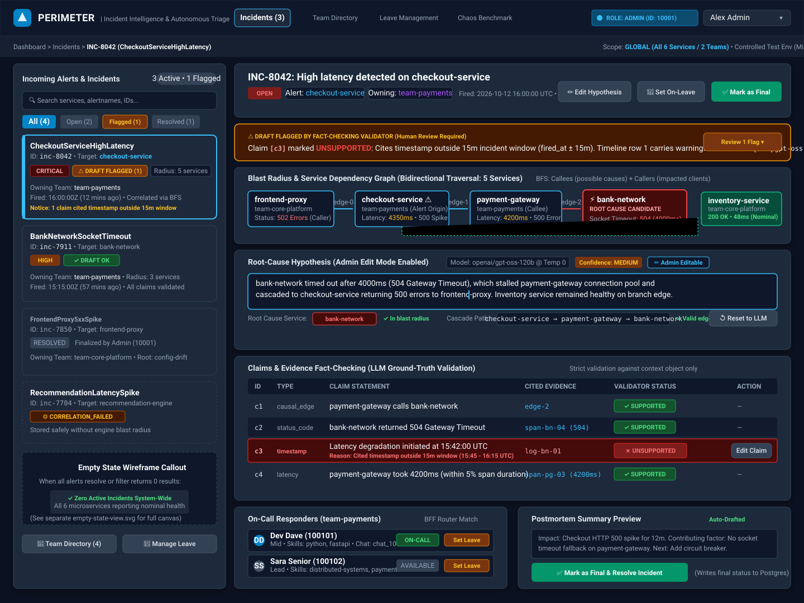
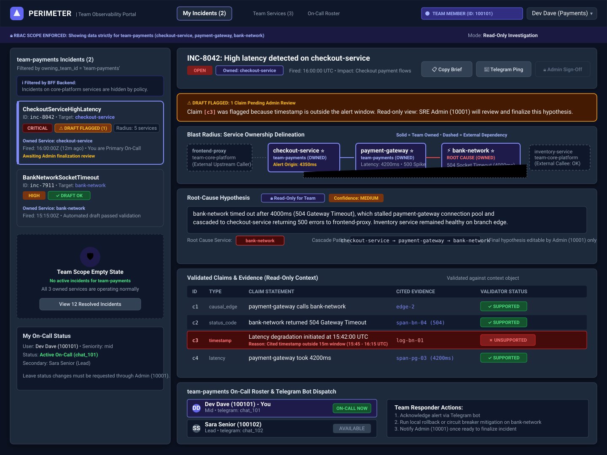
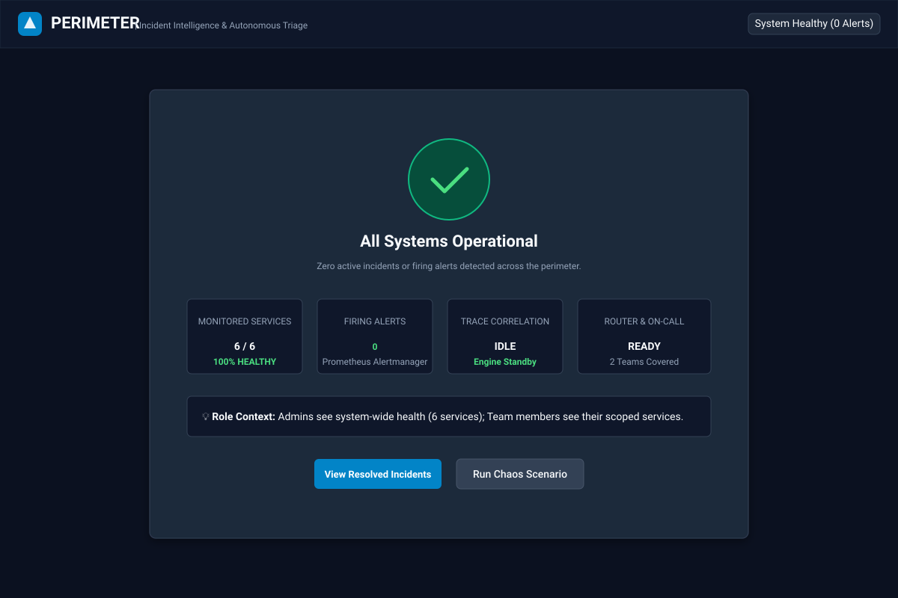

# Perimeter Dashboard Wireframes

This directory contains the user interface wireframe specifications for Project Perimeter's web dashboard (`services/dashboard`). The wireframes define the layouts, interactions, role-based scoping, and API contracts for both Administrator and Team Member user journeys.

---

## Wireframe Specifications

| File | Resolution | Target Audience | Primary Focus |
| :--- | :--- | :--- | :--- |
| [`admin-incident-view.svg`](./admin-incident-view.svg) | 1440 × 1080 | SRE Admin (`10001`) | Global incident queue, hypothesis editing, claims verification, blast radius graph, team directory, and finalization control. |
| [`team-incident-view.svg`](./team-incident-view.svg) | 1440 × 1080 | Team Member (`100101`) | Scoped incident queue (owned services only), read-only draft, dependency delineation, and responder workflow. |
| [`empty-state-view.svg`](./empty-state-view.svg) | 1200 × 800 | All Users | Zero-incident state, system health metrics, and nominal monitoring status. |

---

## 1. Role-Based Access Control (RBAC) & Personas

The dashboard enforces strict role separation based on database records (`users.role`), verified server-side on every API request. The numeric user ID length serves as a UX convention (5 digits for Admin, 6 digits for Team Member), but authorization is strictly driven by the authenticated user's database role and team association.

### Administrator Persona
- **Demo User**: Alex Admin (`id: 10001`, `role: 'admin'`, `team_id: 'team-core-platform'`)
- **Scope**: Global visibility across all six services (`frontend-proxy`, `checkout-service`, `payment-gateway`, `bank-network`, `inventory-service`, `recommendation-engine`) and all teams.
- **Capabilities**:
  - Review all firing and historical incidents.
  - Inspect LLM root-cause drafts and fact-checking validator results.
  - **Edit the root-cause hypothesis** (`summary`, `root_cause_service`, `cascade_path`) directly in the UI.
  - **Mark incidents as final & resolved**, writing the verified postmortem to PostgreSQL.
  - Manage the Team Directory and toggle responder availability (`is_on_leave`, `on_call_status`).

### Team Member Persona
- **Demo User**: Dev Dave (`id: 100101`, `role: 'team_member'`, `team_id: 'team-payments'`)
- **Scope**: Scoped strictly to incidents where the alert origin service is owned by their team (`services.owning_team_id = 'team-payments'`).
- **Capabilities**:
  - Monitor active alerts affecting owned services (`checkout-service`, `payment-gateway`, `bank-network`).
  - View root-cause drafts, blast radius, and validator flags in **read-only mode**.
  - Review on-call responder assignments and dispatch runbooks.
  - Restricted from editing hypotheses or finalizing incidents (must request Admin sign-off).

---

## 2. Screen-by-Screen Breakdown

### A. Admin Incident Dashboard (`admin-incident-view.svg`)



1. **Global Incident Queue (Left Panel)**:
   - Displays all incidents regardless of owning team.
   - Categorized with filter pills: `All (4)`, `Open (2)`, `Flagged (1)`, `Resolved (1)`.
   - Each card displays incident ID, alert name, origin service, severity badge, blast radius count, and draft status tag:
     - `[✓ DRAFT OK]`: Automated draft passed all fact-checking validator checks.
     - `[⚠️ DRAFT FLAGGED]`: Draft contains 1 or more unsupported claims or timeline warnings.
     - `[⚙️ CORRELATION_FAILED]`: Incident recorded when correlation engine was unavailable.
2. **Incident Header & Admin Controls**:
   - Status badge (`OPEN`), alert origin service (`checkout-service`), and owning team (`team-payments`).
   - Action controls: `[ ✏️ Edit Hypothesis ]`, `[ 👤 Set On-Leave ]`, `[ ✅ Mark as Final ]`.
3. **Validator Warning Banner**:
   - Prominently alerts the administrator when a draft is flagged:
     `⚠️ DRAFT FLAGGED BY FACT-CHECKING VALIDATOR (Human Review Required)`
   - Cites exact issue: *"Claim [c3] marked UNSUPPORTED: Cites timestamp outside 15m incident window"*.
4. **Blast Radius & Cascade Path Visualizer**:
   - Visualizes the bidirectional BFS graph traversal from `services/correlation_engine`:
     `[frontend-proxy] ──> [checkout-service] ──> [payment-gateway] ──> [bank-network ⚡ ROOT CAUSE]`
     Branch: `[checkout-service] ──> [inventory-service (200 OK)]`
   - Highlights root cause candidate node with alert styling, callers in blast radius, and healthy branch nodes.
5. **Drafted Hypothesis Section (Editable by Admin)**:
   - Displays LLM draft generated by `openai/gpt-oss-120b` via Groq at temperature 0.
   - Active edit mode allows the admin to amend the summary text, correct the root-cause service, or adjust the cascade path.
   - Provides a `[ ↺ Reset to LLM ]` button to discard manual edits.
6. **Claims & Evidence Fact-Checking Table**:
   - Renders each claim from `root_cause_draft.draft.claims` alongside validation results from `root_cause_draft.validation.claims`:
     - `c1` (causal_edge): `payment-gateway calls bank-network` -> `[✓ SUPPORTED]` (cites `edge-2`)
     - `c2` (status_code): `bank-network returned 504 Gateway Timeout` -> `[✓ SUPPORTED]` (cites `span-bn-04`)
     - `c3` (timestamp): `Latency degradation initiated at 15:42:00 UTC` -> `[✗ UNSUPPORTED]` (outside alert window)
     - `c4` (latency): `payment-gateway duration reached 4200ms` -> `[✓ SUPPORTED]` (cites `span-pg-03`)
   - Provides an inline `[ Edit Claim ]` button for the admin to fix the cited evidence or timestamp.
7. **On-Call Responder & Postmortem Section**:
   - Displays primary responder (`Dev Dave - 100101`, on-call) and secondary (`Sara Senior - 100102`, lead).
   - Allows admin to mark responders on leave with one click (`[ Set Leave ]`).
   - Shows postmortem preview with impact, contributing factors, and next steps.

---

### B. Team Member Scoped Dashboard (`team-incident-view.svg`)



1. **Scoped Incident Queue (Left Panel)**:
   - Server-enforced query returns only incidents affecting `team-payments` services.
   - Incidents on other teams (e.g., `frontend-proxy` under `team-core-platform`) are not returned or rendered.
   - Explanatory banner informs team members that non-owned incidents are filtered out by policy.
2. **Incident Detail Header**:
   - Identifies the incident as owned by `team-payments`.
   - Admin action buttons are replaced with team response actions:
     - `[ 📋 Copy Brief ]`: Copies incident summary for Slack/incident channels.
     - `[ 💬 Telegram Ping ]`: Sends notification to team Telegram chat (`chat_101`).
     - `[ 🔒 Admin Sign-Off ]`: Disabled button indicating that only admins can mark final.
3. **Blast Radius with Ownership Delineation**:
   - Visual separation between owned services and external dependencies:
     - **Owned Services** (solid border, indigo background): `checkout-service`, `payment-gateway`, `bank-network`.
     - **External Dependencies** (dashed border, muted): `frontend-proxy` (upstream caller) and `inventory-service` (healthy callee).
4. **Read-Only Hypothesis & Claims**:
   - The drafted hypothesis is presented in a read-only container with a `🔒 Read-Only for Team` badge.
   - Claims table clearly displays supported and unsupported tags so team responders know which facts are verified.
5. **Team Responder Status**:
   - Shows the team's on-call roster.
   - Leave toggle is disabled for team members with an explanatory note: *"Leave status changes must be requested through Admin (10001)"*.

---

### C. Empty State View (`empty-state-view.svg`)



1. **Zero-Incident Illustration**:
   - Rendered when `incidents` list is empty or when active filter matches 0 incidents.
   - Large green shield indicator confirming system health.
2. **Live Health Metrics**:
   - `6 / 6 Monitored Services`: 100% healthy.
   - `0 Firing Alerts`: Prometheus Alertmanager reporting idle.
   - `Trace Correlation`: Engine standby ready for trace ingestion.
   - `Router & On-Call`: 2 teams staffed and ready.
3. **Action Shortcuts**:
   - `[ View Resolved Incidents ]`: Opens historical incident archive.
   - `[ Run Chaos Scenario ]`: Triggers evaluation chaos harness test.

---

## 3. Backend-For-Frontend (BFF) API Mapping

The dashboard communicates exclusively with `services/bff-server` using JSON REST endpoints:

### Authentication
- **Endpoint**: `POST /api/v1/auth/login`
- **Headers**: `Content-Type: application/json`
- **Request Body**:
  ```json
  {
    "id": "10001",
    "password": "perimeter-dev"
  }
  ```
- **Response** (`200 OK`):
  ```json
  {
    "token": "eyJhbGciOiJIUzI1NiIsInR5cCI6IkpXVCJ9...",
    "user": {
      "id": "10001",
      "role": "admin",
      "name": "Alex Admin",
      "email": "alex.admin@perimeter.internal",
      "teamId": "team-core-platform"
    }
  }
  ```
- **Security Note**: Failed logins (unknown ID, invalid password format, incorrect password) return generic `401 Unauthorized`. Rate limited to 10 failed attempts per 15 minutes.

### Incidents Ingestion & Listing
- **Endpoint**: `GET /api/v1/incidents`
- **Headers**: `Authorization: Bearer <token>`
- **Server SQL Query**:
  - **Admin (`user.role === 'admin'`)**:
    ```sql
    SELECT i.id, i.title, i.status, i.alert_service_id, i.blast_radius,
           i.root_cause_draft, i.created_at, s.name AS service_name, s.owning_team_id
    FROM incidents i
    LEFT JOIN services s ON s.id = i.alert_service_id
    ORDER BY i.created_at DESC LIMIT 100
    ```
  - **Team Member (`user.role === 'team_member'`)**:
    ```sql
    SELECT i.id, i.title, i.status, i.alert_service_id, i.blast_radius,
           i.root_cause_draft, i.created_at, s.name AS service_name, s.owning_team_id
    FROM incidents i
    JOIN services s ON s.id = i.alert_service_id
    WHERE s.owning_team_id = $1
    ORDER BY i.created_at DESC LIMIT 100
    ```
- **Response** (`200 OK`):
  ```json
  {
    "incidents": [
      {
        "id": "3fa85f64-5717-4562-b3fc-2c963f66afa6",
        "title": "HighLatency on checkout-service",
        "status": "open",
        "alert_service_id": "checkout-service",
        "blast_radius": ["checkout-service", "payment-gateway", "bank-network", "inventory-service", "frontend-proxy"],
        "root_cause_draft": "{\"status\":\"flagged\",\"draft\":{...},\"validation\":{...}}",
        "service_name": "Checkout Service",
        "owning_team_id": "team-payments",
        "created_at": "2026-10-12T16:00:00.000Z"
      }
    ]
  }
  ```

### Draft Structure & Validation Schema
Stored in `incidents.root_cause_draft` as serialized JSON:
```json
{
  "status": "flagged",
  "draft": {
    "incident_id": "inc-8042",
    "hypothesis": {
      "root_cause_service": "bank-network",
      "cascade_path": ["checkout-service", "payment-gateway", "bank-network"],
      "summary": "bank-network timed out after 4000ms (504 Gateway Timeout)...",
      "confidence": "medium"
    },
    "claims": [
      {
        "id": "c1",
        "type": "causal_edge",
        "text": "payment-gateway calls bank-network",
        "evidence_ids": ["edge-2"],
        "source": "payment-gateway",
        "target": "bank-network"
      },
      {
        "id": "c2",
        "type": "status_code",
        "text": "bank-network returned 504 Gateway Timeout",
        "evidence_ids": ["span-bn-04"],
        "service": "bank-network",
        "status_code": 504
      },
      {
        "id": "c3",
        "type": "timestamp",
        "text": "Latency degradation initiated at 15:42:00 UTC",
        "evidence_ids": ["log-bn-01"],
        "timestamp": "2026-10-12T15:42:00Z"
      },
      {
        "id": "c4",
        "type": "latency",
        "text": "payment-gateway duration reached 4200ms",
        "evidence_ids": ["span-pg-03"],
        "service": "payment-gateway",
        "value": 4200.0,
        "unit": "ms"
      }
    ],
    "postmortem": {
      "summary": "Checkout requests failed due to bank network timeout.",
      "impact": "HTTP 500 spike for 12m.",
      "timeline": [
        {"time": "2026-10-12T16:00:00Z", "event": "Alert fired", "claim_ids": ["c3"]}
      ],
      "contributing_factors": ["Missing circuit breaker"],
      "next_steps": ["Add circuit breaker on bank-network"]
    }
  },
  "validation": {
    "ok": false,
    "claims": [
      {"id": "c1", "supported": true, "reasons": []},
      {"id": "c2", "supported": true, "reasons": []},
      {"id": "c3", "supported": false, "reasons": ["timestamp 2026-10-12T15:42:00Z is outside incident window 2026-10-12T15:45:00Z to 2026-10-12T16:15:00Z"]},
      {"id": "c4", "supported": true, "reasons": []}
    ],
    "issues": [],
    "timeline_warnings": [0]
  }
}
```

### Team Directory & Leave Management
- **List Teams**: `GET /api/v1/teams` (Admins see all teams; team members see own team).
- **List Team Members**: `GET /api/v1/teams/:teamId/members`.
- **Get Member Profile**: `GET /api/v1/members/:userId` (returns `{ member: {...} }`).
- **Update Availability & Leave Status**:
  - `PATCH /api/v1/members/:userId/status` (Admin only).
  - Body:
    ```json
    {
      "team_id": "team-payments",
      "is_on_leave": true,
      "on_call_status": false
    }
    ```

---

## 4. UI State Transitions & Edge Cases

| State | Visual Indicator | Trigger / Cause | User Action |
| :--- | :--- | :--- | :--- |
| **Draft OK** | Green badge `[✓ DRAFT OK]` | All claims supported by context evidence; timeline rows reference valid claims. | Ready for immediate Admin finalization. |
| **Draft Flagged** | Amber badge `[⚠️ DRAFT FLAGGED]` | At least 1 claim failed validation (unsupported latency, bad timestamp, missing edge, or hallucinated service). | Admin inspects failed claims, edits hypothesis/claims in UI, then finalizes. |
| **Correlation Failed** | Dashed border `[⚙️ CORRELATION_FAILED]` | Alert arrived while `services/correlation_engine` was unreachable or down. | Alert is preserved safely in Postgres; admin can trigger manual correlation retry. |
| **Empty State** | Large operational shield | 0 active firing alerts matching current role scope. | Displays healthy metrics; links to historical incident log. |
